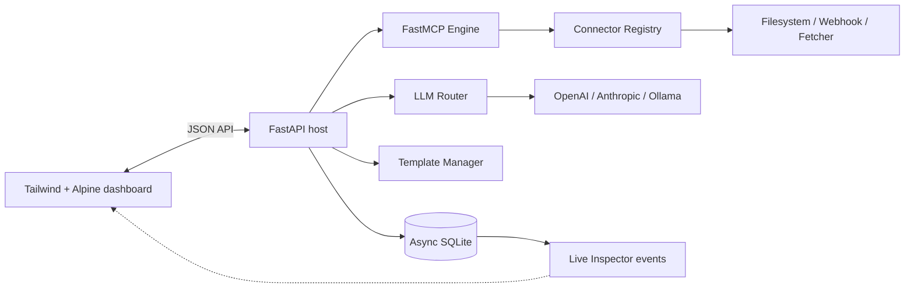

# MCP Nexus

[](https://www.python.org/)
[](https://modelcontextprotocol.io/)
[](LICENSE)

**MCP Nexus is a local-first MCP hub for connecting LLMs, tools, prompt
templates, and observable protocol traffic through one clean web workspace.**

It provides a FastAPI host, an official FastMCP server, async SQLite
persistence, direct adapters for OpenAI/Anthropic/Ollama, and a zero-build
Tailwind/Alpine dashboard.

> **Current status:** Phases 1–5 complete. The project is an extensible
> foundation for local MCP workflows; streaming transport and additional
> provider features are natural next steps.

## Features

- **LLM Hub:** normalized chat requests for OpenAI, Anthropic, and local Ollama.
- **Connect Stuff:** sandboxed filesystem tools, a web fetcher, and webhook
  sender registered dynamically through a connector registry.
- **Send Stuff safety:** outbound webhooks require explicit confirmation by
  default.
- **Template Studio:** save and render `{{ variable }}` prompt templates.
- **Live Inspector:** persist and inspect structured request/response events.
- **Local-first operation:** credentials stay in environment variables and state
  stays in SQLite.

## Architecture



See [`docs/ARCHITECTURE.md`](docs/ARCHITECTURE.md) for the design principles
and [`docs/DEVLOG.md`](docs/DEVLOG.md) for the incremental build history.

## Quickstart

### 1. Install

Requires Python 3.12 or newer.

```powershell
git clone https://github.com/BMKoscak/mcp.git
cd mcp
python -m venv .venv
.venv\Scripts\Activate.ps1
python -m pip install -e ".[dev]"
Copy-Item .env.example .env
```

### 2. Configure a model provider

Set one provider in `.env`:

```dotenv
# Local Ollama (default)
OLLAMA_BASE_URL=http://127.0.0.1:11434

# Or hosted providers
OPENAI_API_KEY=your-key
ANTHROPIC_API_KEY=your-key
```

### 3. Run the host

```powershell
python -m uvicorn mcp_nexus.main:app --reload
```

Open <http://127.0.0.1:8000>. The dashboard exposes chat, connectors, templates,
and the protocol event inspector.

### 4. Run checks

```powershell
python -m pytest -q
python -m ruff check src tests
```

## Add a connector in under 20 lines

Connector factories receive a FastMCP server and return a named registry entry:

```python
from mcp_nexus.services.registry import Connector

def clock_connector() -> Connector:
    def register(server):
        @server.tool(name="current_time", description="Return a UTC timestamp.")
        async def current_time() -> str:
            from datetime import datetime, timezone
            return datetime.now(timezone.utc).isoformat()
    return Connector(name="clock", register=register)
```

Register the factory in `MCPEngine.__init__`, or build your own registry and
call `registry.register_all(server)`.

## API overview

| Endpoint | Purpose |
| --- | --- |
| `GET /health` | Host health check |
| `GET /api/connectors` | Registered MCP connectors |
| `GET /api/providers` | Provider configuration status without secrets |
| `POST /api/providers/{provider}/test` | Test provider reachability |
| `GET /api/events` | Persisted inspector events |
| `GET /api/events/stream` | Server-Sent Events stream for new inspector events |
| `GET /api/templates` | Saved prompt templates |
| `POST /api/templates` | Save or replace a template |
| `POST /api/templates/{name}/render` | Render a template with variables |
| `POST /api/chat` | Route a normalized chat request |

## Repository layout

```text
docs/                 Architecture and development history
frontend/             Zero-build browser dashboard
src/mcp_nexus/
  connectors/         MCP connector factories
  services/           Database, registry, and LLM routing
  templates/          Prompt template manager
  main.py             FastAPI application
  mcp_engine.py       FastMCP server assembly
tests/                Focused unit and API tests
```

## License

MCP Nexus is released under the [MIT License](LICENSE).
