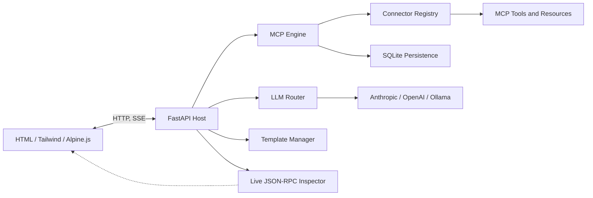

# MCP Nexus Architecture

## Purpose

MCP Nexus is a local-first control plane for using multiple LLM providers with
MCP tools and prompt templates. The system is designed to keep credentials and
tool execution local while making model/tool interactions visible in a browser.

## Phase 1 boundaries

Phase 1 establishes the package and documentation boundaries. Runtime behavior
is intentionally deferred to later phases:

- `src/mcp_nexus/` contains the Python application package.
- `src/mcp_nexus/connectors/` contains MCP tool/resource plugins.
- `src/mcp_nexus/services/` contains persistence, routing, and orchestration
  services.
- `src/mcp_nexus/templates/` contains prompt-template support.
- `frontend/` contains the browser application assets.
- `tests/` contains unit and integration tests.

## Target component model

## Design principles

1. **Local-first:** provider credentials, SQLite state, and connector execution
   remain on the user's machine by default.
2. **Explicit outbound actions:** webhook, email, and notification actions are
   confirmation-gated by default.
3. **Composable connectors:** each connector should have a small, testable
   registration surface and should not depend on the web UI.
4. **Observable protocol traffic:** JSON-RPC requests and responses are captured
   as structured events so users can inspect exact MCP interactions.
5. **Async by default:** network, persistence, and model operations use async
   interfaces to keep the FastAPI host responsive.

## Planned runtime flow

1. The browser submits a chat, tool, or template execution request.
2. FastAPI validates the request and emits an execution event.
3. The LLM router selects the configured provider/model.
4. The MCP engine exposes the registered tools and resources to the host/model.
5. Connector results are persisted and streamed to the browser.
6. The inspector renders the corresponding JSON-RPC request/response sequence.

